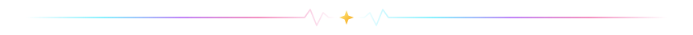

  <a href="https://git.cafe/neontechspace"><picture><source media="(prefers-color-scheme: dark)" srcset="./assets/hero-dark.svg"><source media="(prefers-color-scheme: light)" srcset="./assets/hero-light.svg"></picture></a>

  <a href="https://git.cafe/neontechspace"><picture><source media="(prefers-color-scheme: dark)" srcset="https://shieldcn.dev/badge/git.cafe-neontechspace-9333ea.svg?variant=branded&amp;split=true&amp;size=sm&amp;label=git.cafe&amp;labelColor=111827&amp;color=9333ea&amp;mode=dark"></picture></a>
  <a href="https://github.com/sponsors/Neonsy"><picture><source media="(prefers-color-scheme: dark)" srcset="https://shieldcn.dev/badge/Sponsor-Neonsy-db2777.svg?variant=branded&amp;split=true&amp;size=sm&amp;label=Sponsor&amp;labelColor=111827&amp;color=db2777&amp;logo=github&amp;mode=dark"></picture></a>

> [!IMPORTANT]
> **Find NeonTechSpace on [git.cafe/neontechspace](https://git.cafe/neontechspace)**
> Browse repositories, track issues, and follow active development on our git.cafe organization page.

## Public projects

| Project | What it is | Links |
| --- | --- | --- |
| **[Fluxerly.js](https://fluxerly.neontechspace.com/)** | Fluxer-native bot SDK for JavaScript, TypeScript, and Effect | [git.cafe](https://git.cafe/neontechspace/fluxerly.js) · [Web](https://fluxerly.neontechspace.com/) · [GitHub](https://github.com/NeonTechSpace/Fluxerly.js) |
| **[NeonFlux](https://neonflux.neontechspace.com/)** | Open-source Fluxer bot built with Fluxerly.js, TypeScript 7, Effect, and Convex | [git.cafe](https://git.cafe/neontechspace/neonflux) · [Web](https://neonflux.neontechspace.com/) · [GitHub](https://github.com/NeonTechSpace/NeonFlux) |

  <picture><source media="(prefers-color-scheme: dark)" srcset="./assets/footer-dark.svg"><source media="(prefers-color-scheme: light)" srcset="./assets/footer-light.svg"></picture>

